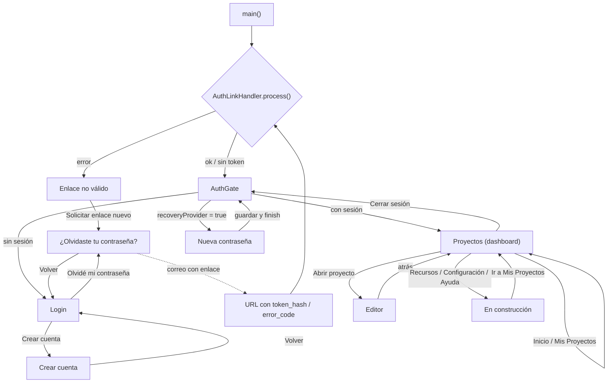

# Árbol de navegación de pantallas

Mapa de todas las rutas de la app, desde el arranque y el login, con la
función/código que dispara cada transición.

> La app **no usa GoRouter ni rutas nombradas**: navega con
> `Navigator.push` / `pop` y `MaterialPageRoute`. Las “pantallas” del editor
> son datos (`ProjectScreen`), no rutas.
>
> Las líneas son orientativas; la referencia estable es el **archivo + función**.

## Diagrama



## Árbol en texto

```
main()                                   lib/main.dart:10
├── AppConfig.load()                     core/config/app_config.dart
├── Supabase.initialize()                main.dart:16
├── AuthLinkHandler.process()            auth/data/auth_link_handler.dart:25
│   ├── ?error_code=… → mensaje         auth_link_handler.dart:29
│   ├── ?token_hash=…&type=… → verifyOTP auth_link_handler.dart:37
│   └── Guarda error en startupAuthErrorProvider
└── runApp(ProviderScope → ModeladorApp) main.dart:28
    └── MaterialApp(home: AuthGate)      main.dart:47-51

AuthGate (decide pantalla)               auth/presentation/auth_gate.dart:22
├── startupAuthError != null && sin sesión
│   └── _AuthLinkErrorScreen             auth_gate.dart:33-43
│       └── “Solicitar enlace nuevo” → ForgotPasswordScreen (push) :39
├── recoveryProvider == true
│   └── ResetPasswordScreen              auth_gate.dart:55-57
├── AsyncData(null)  → LoginScreen       auth_gate.dart:60-61
├── AsyncData(user)  → ProjectsScreen    auth_gate.dart:60-61
├── AsyncError       → _AuthErrorScreen  auth_gate.dart:62-66
└── loading          → spinner           auth_gate.dart:67

LoginScreen                              auth/presentation/login_screen.dart
├── “Crear cuenta” → SignUpScreen (push) :69-71
├── “¿Olvidaste tu contraseña?” → ForgotPasswordScreen (push) :75-77
└── login exitoso → authStateProvider cambia → AuthGate → Projects

SignUpScreen                             auth/presentation/signup_screen.dart
├── éxito → panel “Revisá tu correo”     :101-109
└── “Volver al login” → pop()            :89, :122

ForgotPasswordScreen                     auth/presentation/forgot_password_screen.dart
├── envío → panel de éxito               :63-71
└── “Volver” → pop()                     :83

ResetPasswordScreen                      auth/presentation/reset_password_screen.dart
└── guardar → recoveryProvider.finish()  :65 → AuthGate re-evalúa

ProjectsScreen (dashboard)               projects/presentation/projects_screen.dart
├── “Abrir proyecto” / tarjeta → EditorScreen (push) :622-625
├── logout → authRepository.signOut()    :131-139 → AuthGate → Login
├── menú móvil → Drawer (secciones)      :70-90
├── Inicio / Mis Proyectos → dashboard   _section 0/1
├── Recursos / Configuración / Ayuda → _ComingSoon
│   └── “Ir a Mis Proyectos” → setState(_section = 1)
├── Nuevo proyecto → _NewProjectDialog   :241
└── Eliminar proyecto → diálogo confirm  :635

EditorScreen                             editor/presentation/editor_screen.dart
├── atrás (AppBar / sistema) → pop → Projects
├── Tema del proyecto → diálogo          :372
├── Renombrar pantalla → diálogo         :1880
├── Selector de color → diálogo          :2554
├── Copiar código → Clipboard (sin ruta)
└── Pestañas de pantalla                 editor/application/editor_session.dart
    ├── selectScreen(id)                 :382
    └── createScreen()                   :416
    (cambian datos del proyecto, no la ruta)
```

## Tabla de transiciones

| Desde | Acción / función | Código | Hacia |
|---|---|---|---|
| Arranque | `AuthLinkHandler.process()` | `auth_link_handler.dart:25` | `AuthGate` |
| Arranque | error de enlace | `auth_gate.dart:33` | Enlace no válido |
| Enlace no válido | Solicitar enlace nuevo | `auth_gate.dart:39` | Recuperar contraseña |
| AuthGate | sin sesión | `auth_gate.dart:61` | Login |
| AuthGate | con sesión | `auth_gate.dart:61` | Proyectos |
| AuthGate | `passwordRecovery` | `auth_gate.dart:55` | Nueva contraseña |
| Login | Crear cuenta | `login_screen.dart:69` | Registro |
| Login | Olvidé contraseña | `login_screen.dart:75` | Recuperar |
| Registro | Volver | `signup_screen.dart:122` | Login |
| Recuperar | Volver | `forgot_password_screen.dart:83` | Login |
| Correo | enlace `token_hash` | `auth_link_handler.dart:37` | AuthGate/Reset |
| Nueva contraseña | guardar | `reset_password_screen.dart:65` | AuthGate |
| Proyectos | Abrir proyecto | `projects_screen.dart:622` | Editor |
| Editor | atrás | AppBar/`canPop` | Proyectos |
| Proyectos | Cerrar sesión | `projects_screen.dart:131` | Login (vía AuthGate) |
| Proyectos | secciones | `_section` | Dashboard / En construcción |

## Observaciones y recomendación

- El **único guardián** de navegación es `AuthGate`; ninguna pantalla decide si
  hay sesión. Eso está bien y evita rutas huérfanas.
- Las transiciones son **imperativas** (`push`/`pop`). Si el número de rutas
  crece, conviene centralizarlas (enum `AppRoute` + `openRoute()`) para tener el
  árbol en un solo lugar y testear cada transición.
- Las pestañas del editor y las secciones del dashboard **no son rutas**: son
  estado (`editorSessionProvider`, `_section`), por eso “atrás” no navega entre
  pantallas del proyecto.
- Deep links: solo se procesan al **arrancar** (`main`). Para soportar enlaces
  con la app abierta habría que escuchar `Uri.base`/`app_links` y re-evaluar
  `recoveryProvider`.
